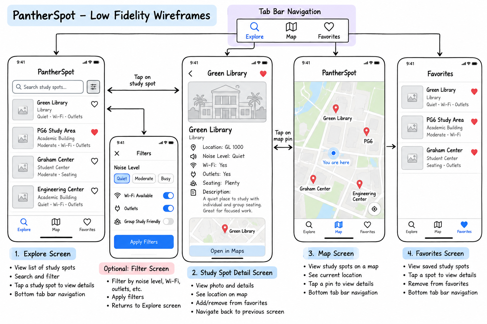
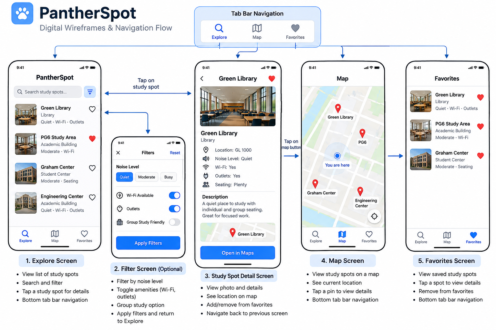
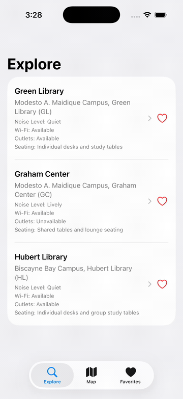

# PantherSpot

## Table of Contents

1. [Overview](#Overview)
2. [Product Spec](#Product-Spec)
3. [Wireframes](#Wireframes)
4. [Schema](#Schema)
5. [Sprint Progress](#sprint-progress)

---

## Overview

### Description

**PantherSpot** is an iOS app designed to help college students find convenient places to study on and around campus.

Students often have time between classes but may not know where they can find a quiet place with seating, Wi-Fi, outlets, or enough space to work with a group. PantherSpot brings this information together in one mobile app.

Users will be able to browse available study locations, view them on a map, see useful details about each location, and save their favorite study spots for quick access later.

The first version of PantherSpot will focus on FIU study locations, but the idea could later be expanded to other college campuses.

### App Evaluation

- **Category:** Education / Productivity / Lifestyle

- **Mobile:** PantherSpot is especially useful as a mobile app because students are likely to search for a study location while already walking around campus. The app can use **Core Location** to determine the user's location and **MapKit** to display nearby study spots. Mobile features such as maps, location services, saved favorites, and possibly photos make the experience more useful than a basic website.

- **Story:** Students frequently need somewhere to study between classes, especially when libraries or their usual locations are crowded. PantherSpot solves this problem by giving students one place to discover study locations and quickly compare useful information such as noise level, seating, outlets, and Wi-Fi availability.

- **Market:** The initial target audience is FIU students, which gives PantherSpot a clearly defined user base. The concept could later expand to other universities by supporting study locations for multiple campuses.

- **Habit:** Students could use PantherSpot several times per week when deciding where to study before or after class. Favorites and nearby-location features encourage users to return instead of repeatedly searching for the same locations.

- **Scope:** PantherSpot has a manageable MVP that can be completed during the course. The required version will focus on browsing locations, viewing details, displaying locations on a map, and saving favorites. More complex features such as ratings, filters, photos, user-submitted locations, or notifications can be added later if time allows.

---

## Product Spec

### 1. User Stories (Required and Optional)

### Required Must-have Stories

- [x] User can view a list of available study spots.
- [x] User can tap a study spot to view detailed information about that location.
- [ ] User can view study spots on a map.
- [x] User can view useful information for each study spot such as noise level, seating, Wi-Fi availability, and outlet availability.
- [x] User can save a study spot as a favorite.
- [x] User can view a list of their saved favorite study spots.
- [ ] User can see their current location in relation to study spots on the map.

### Optional Nice-to-have Stories

- [ ] User can filter study spots by characteristics such as noise level, outlets, Wi-Fi, or group-study availability.
- [ ] User can search for a study spot by name.
- [ ] User can view photos of study locations.
- [ ] User can add a rating or personal note to a study spot.
- [ ] User can submit a new study location.
- [ ] User can sort study spots based on distance from their current location.
- [ ] User can receive a notification reminding them about a saved study location.
- [ ] User can view additional information such as building hours when available.

---

### 2. Screen Archetypes

- [x] **Explore / Study Spot List Screen**
  - User can view a list of available study spots.
  - Each list item displays basic information such as the study spot name, location, and general study environment.
  - User can tap a study spot to open its detail screen.
  - Optional search and filtering controls can be added to this screen.

- [x] **Study Spot Detail Screen**
  - User can view detailed information about a selected study spot.
  - Shows the spot's name, description, building or area, noise level, seating, Wi-Fi, and outlet availability.
  - User can add or remove the study spot from their favorites.
  - Planned for Sprint 2: view the study spot's location on a map.

- [ ] **Map Screen**
  - User can view study spots as annotations on a map.
  - User can see their current location.
  - User can tap a map annotation to view information about a study spot.
  - User can navigate from a selected annotation to the Study Spot Detail Screen.

- [x] **Favorites Screen**
  - User can view study spots they previously saved.
  - User can tap a favorite study spot to open its detail screen.
  - User can remove a study spot from favorites.

### Optional Screens

- [ ] **Filter Screen / Filter Sheet**
  - User can select filters such as quiet locations, outlets, Wi-Fi, or group-study spaces.
  - The selected filters update the study spots shown in Explore.

- [ ] **Add Study Spot Screen**
  - User can enter information about a new study location.
  - User can optionally attach a photo and location.
  - This screen would be implemented only if time allows.

---

### 3. Navigation

### Tab Navigation (Tab to Screen)

PantherSpot uses a bottom tab bar with three main sections:

- [x] **Explore**
  - Opens the Study Spot List Screen.

- [x] **Map**
  - Opens the Map placeholder. MapKit features are planned for Sprint 2.

- [x] **Favorites**
  - Opens the Favorites Screen.

---

### Flow Navigation (Screen to Screen)

- [x] **Explore / Study Spot List Screen**
  - Tapping a study spot leads to the **Study Spot Detail Screen**.
  - Planned for Sprint 2: tapping filter controls opens the **Filter Screen / Sheet**.

- [x] **Study Spot Detail Screen**
  - User can return to the previous screen.
  - User can add or remove the study spot from favorites.
  - Planned for Sprint 2: view the location of the study spot on a map.

- [ ] **Map Screen**
  - Tapping a study spot annotation displays information about that location.
  - Selecting the location leads to the **Study Spot Detail Screen**.

- [x] **Favorites Screen**
  - Tapping a saved study spot leads to the **Study Spot Detail Screen**.
  - Removing a favorite updates the Favorites Screen.

- [ ] **Filter Screen / Sheet**
  - Applying filters returns the user to the **Explore Screen** with updated results.
  - Canceling returns the user to the **Explore Screen** without changing the current results.

- [ ] **Add Study Spot Screen** *(Optional)*
  - Saving a new study spot returns the user to the **Explore Screen**.
  - Canceling returns the user to the previous screen.

---

## Wireframes

The following wireframe shows the main PantherSpot screens and navigation flow, including the Explore, Study Spot Detail, Map, Favorites, and Filter screens.

### [BONUS] Digital Wireframes & Mockups

The following digital mockup provides a cleaner visual representation of the planned PantherSpot interface while keeping the same features and navigation from the product spec.

The digital mockup includes:

- Explore screen with study spot cards, search, and filtering
- Filter screen for noise level and amenities
- Study Spot Detail screen with location details and favorite controls
- Map screen showing nearby study spot markers
- Favorites screen with saved study locations
- Consistent bottom tab navigation between the main screens

### [BONUS] Interactive Prototype

Not implemented at this milestone.

---

## Schema

### Models

Sprint 1 uses a `StudySpot` model and three sample FIU locations: Green Library, Graham Center, and Hubert Library. The amenity values are sample data for development.

| Property | Type | Description |
| --- | --- | --- |
| `id` | `UUID` | Identifies a study spot |
| `name` | `String` | Study spot name |
| `location` | `String` | Campus and building |
| `description` | `String` | Short description of the spot |
| `noiseLevel` | `String` | Study environment, such as Quiet or Lively |
| `hasWiFi` | `Bool` | Whether Wi-Fi is available |
| `hasOutlets` | `Bool` | Whether outlets are available |
| `seatingInfo` | `String` | Description of the seating |

`FavoritesManager` keeps a set of favorite study spot IDs shared by Explore and Favorites. Favorites currently last for the app session. Saving them between launches is planned for Sprint 2.

### Networking

Sprint 1 reads local sample data and makes no network requests. Maps and current-location features are planned for Sprint 2.

---

## Sprint Progress

### Sprint 1 — Core App Foundation (Unit 8)

We finished the SwiftUI project setup, tab navigation, study spot model, Explore list, detail screen, and favorites flow. Issues #1–#8 are complete and their pull requests are merged.

- [x] Browse three sample FIU study spots with location and amenity information.
- [x] Open the selected spot's details and return to Explore.
- [x] Add and remove favorites from Explore and the detail screen.
- [x] View saved spots in Favorites and open their details.
- [x] Show an empty state when no favorites are saved.
- [x] Switch between Explore, Map, and Favorites tabs. The Map tab is a placeholder for Sprint 2.

#### Sprint 1 Demo

The walkthrough shows Explore, study spot details, adding favorites, opening details from Favorites, removing saved spots, and the empty state.

#### Project Tracking

- [PantherSpot Development board](https://github.com/orgs/PantherSpot-Team/projects/3)
- [Sprint 1 milestone](https://github.com/PantherSpot-Team/PantherSpot/milestone/1)
- [Sprint 2 milestone](https://github.com/PantherSpot-Team/PantherSpot/milestone/2)
- [Sprint 3 milestone](https://github.com/PantherSpot-Team/PantherSpot/milestone/3)

### Sprint 2 Plan

Issues #9–#16 are created, assigned to the team members below, and added to the project board in Backlog under the Sprint 2 milestone.

| Team member | Issues | Work |
| --- | --- | --- |
| Alejandro (`aperez-999`) | #9, #10, #11, #12 | MapKit screen, study spot pins, current location, and navigation from a pin to details |
| Pedro (`Pedrito0813`) | #13, #14 | Save favorites between launches and add study spot search |
| Chris (`chriswynns2007`) | #15 | Add filter controls and reset options |
| Sreeman (`SRM-bot-ship`) | #16 | Apply selected filters to Explore results |

### Sprint 3 Plan

We plan to finish maps and saved favorites in Sprint 2. For Sprint 3, we will focus on testing, fixing bugs, checking layout and accessibility, and getting the demo and README ready for submission.
