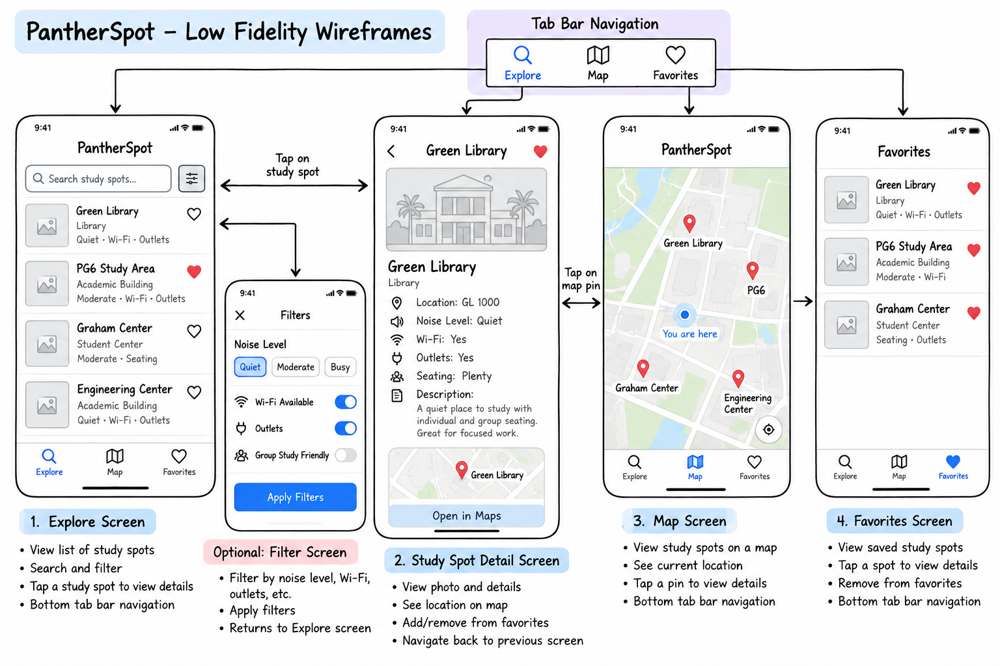
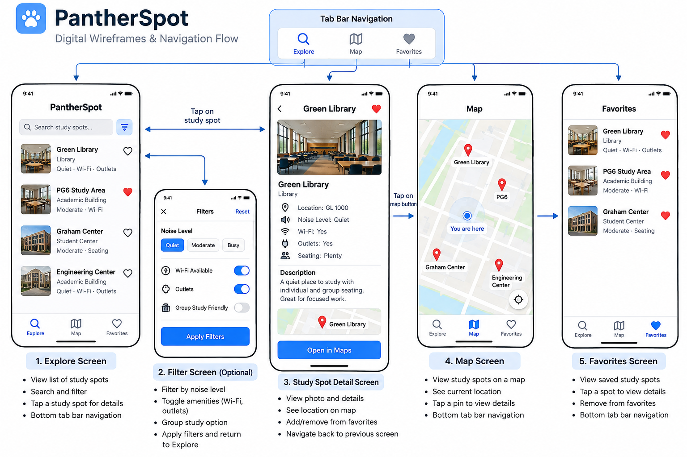
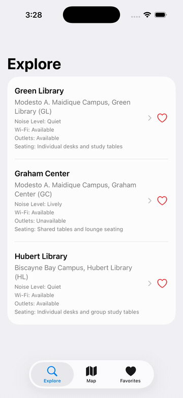
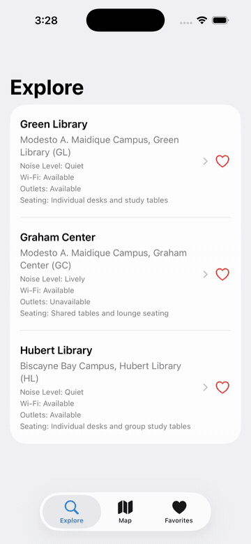
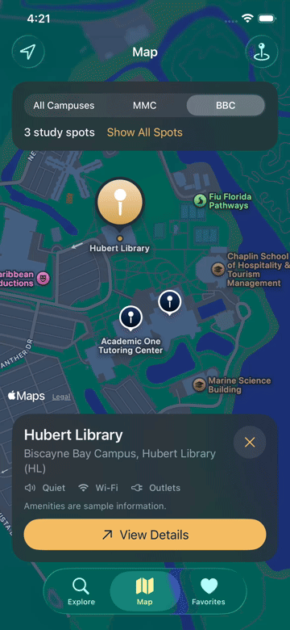

# PantherSpot

## Table of Contents

1. [Overview](#overview)
2. [Product Spec](#product-spec)
3. [Wireframes](#wireframes)
4. [Schema](#schema)
5. [Sprint Progress](#sprint-progress)

---

## Overview

### Description

**PantherSpot** is an iOS app designed to help college students find convenient places to study on and around campus.

Students often have time between classes but may not know where they can find a quiet place with seating, Wi-Fi, outlets, or enough space to work with a group. PantherSpot brings this information together in one mobile app.

Users can browse study locations, view them on a map, compare useful details, and save their favorite study spots for quick access later.

The first version of PantherSpot focuses on FIU study locations, but the idea could later be expanded to other college campuses.

### App Evaluation

- **Category:** Education / Productivity / Lifestyle

- **Mobile:** PantherSpot is especially useful as a mobile app because students are likely to search for a study location while already walking around campus. The app uses **Core Location** for optional current location and **MapKit** to display study spots. Maps, location services, and saved favorites help students find and return to a place while on campus.

- **Story:** Students frequently need somewhere to study between classes, especially when libraries or their usual locations are crowded. PantherSpot solves this problem by giving students one place to discover study locations and quickly compare useful information such as noise level, seating, outlets, and Wi-Fi availability.

- **Market:** The initial target audience is FIU students, which gives PantherSpot a clearly defined user base. The concept could later expand to other universities by supporting study locations for multiple campuses.

- **Habit:** Students could use PantherSpot several times per week when deciding where to study before or after class. Favorites and nearby-location features encourage users to return instead of repeatedly searching for the same locations.

- **Scope:** PantherSpot has a manageable MVP that can be completed during the course. The app supports browsing locations, viewing details, maps, saved favorites, search, and filters. Ratings, photos, user-submitted locations, and notifications remain possible future additions.

---

## Product Spec

### 1. User Stories (Required and Optional)

### Required Must-have Stories

- [x] User can view a list of available study spots.
- [x] User can tap a study spot to view detailed information about that location.
- [x] User can view study spots on a map.
- [x] User can view useful information for each study spot such as noise level, seating, Wi-Fi availability, and outlet availability.
- [x] User can save a study spot as a favorite.
- [x] User can view a list of their saved favorite study spots.
- [x] User can keep saved favorites after closing and reopening the app.
- [x] User can see their current location in relation to study spots on the map.

### Optional Nice-to-have Stories

- [x] User can filter study spots by characteristics such as noise level, outlets, Wi-Fi, or group-study availability.
- [x] User can search for a study spot by name.
- [ ] User can view photos of study locations.
- [ ] User can add a rating or personal note to a study spot.
- [ ] User can submit a new study location.
- [ ] User can sort study spots based on distance from their current location.
- [ ] User can receive a notification reminding them about a saved study location.
- [ ] User can view additional information such as building hours when available.

---

### 2. Screen Archetypes

- [x] **Explore / Study Spot List Screen**
  - User can view a list of available study spots.
  - Each list item displays basic information such as the study spot name, location, and general study environment.
  - User can tap a study spot to open its detail screen.
  - Search by name, building, or campus and combine the query with filters.

- [x] **Study Spot Detail Screen**
  - User can view detailed information about a selected study spot.
  - Shows the spot's name, description, building or area, noise level, seating, Wi-Fi, and outlet availability.
  - User can add or remove the study spot from their favorites.
  - View the study spot's location on a map.

- [x] **Map Screen**
  - User can view study spots as annotations on a map.
  - User can see their current location.
  - User can tap a map annotation to view information about a study spot.
  - User can navigate from a selected annotation to the Study Spot Detail Screen.

- [x] **Favorites Screen**
  - User can view study spots they previously saved.
  - User can tap a favorite study spot to open its detail screen.
  - User can remove a study spot from favorites.

### Optional Screens

- [x] **Filter Screen / Filter Sheet**
  - User can select filters such as quiet locations, outlets, Wi-Fi, or group-study spaces.
  - The selected filters update the study spots shown in Explore.

- [ ] **Add Study Spot Screen**
  - User can enter information about a new study location.
  - User can optionally attach a photo and location.
  - This screen would be implemented only if time allows.

---

### 3. Navigation

### Tab Navigation (Tab to Screen)

PantherSpot uses a bottom tab bar with three main sections:

- [x] **Explore**
  - Opens the Study Spot List Screen.

- [x] **Map**
  - Opens the campus map with study spot pins and an optional current-location control.

- [x] **Favorites**
  - Opens the Favorites Screen.

---

### Flow Navigation (Screen to Screen)

- [x] **Explore / Study Spot List Screen**
  - Tapping a study spot leads to the **Study Spot Detail Screen**.
  - Tapping Filters opens the **Filter Screen / Sheet**.

- [x] **Study Spot Detail Screen**
  - User can return to the previous screen.
  - User can add or remove the study spot from favorites.
  - View the location of the study spot on a map and open walking directions in Apple Maps.

- [x] **Map Screen**
  - Tapping a study spot annotation displays information about that location.
  - Selecting the location leads to the **Study Spot Detail Screen**.

- [x] **Favorites Screen**
  - Tapping a saved study spot leads to the **Study Spot Detail Screen**.
  - Removing a favorite updates the Favorites Screen.

- [x] **Filter Screen / Sheet**
  - Applying filters returns the user to the **Explore Screen** with updated results.
  - Canceling returns the user to the **Explore Screen** without changing the current results.

- [ ] **Add Study Spot Screen** *(Optional)*
  - Saving a new study spot returns the user to the **Explore Screen**.
  - Canceling returns the user to the previous screen.

---

## Wireframes

The following wireframe shows the main PantherSpot screens and navigation flow, including the Explore, Study Spot Detail, Map, Favorites, and Filter screens.

### [BONUS] Digital Wireframes & Mockups

The following digital mockup provides a cleaner visual representation of the planned PantherSpot interface while keeping the same features and navigation from the product spec.

The digital mockup includes:

- Explore screen with study spot cards, search, and filtering
- Filter screen for noise level and amenities
- Study Spot Detail screen with location details and favorite controls
- Map screen showing nearby study spot markers
- Favorites screen with saved study locations
- Consistent bottom tab navigation between the main screens

### [BONUS] Interactive Prototype

The wireframes above guided the SwiftUI implementation. We did not create a separate interactive prototype.

---

## Schema

### Models

The `StudySpot` catalog now includes six FIU locations across MMC and BBC. Sprint 1 started with Green Library, Graham Center, and Hubert Library; the expanded catalog adds Starbucks at MANGO, Wolfe University Center, and the Academic One Tutoring Center. Amenity values remain sample information. Building references, coordinates, and access notes are recorded in [study spot sources](study-spot-sources.md).

| Property | Type | Description |
| --- | --- | --- |
| `id` | `UUID` | Identifies a study spot |
| `name` | `String` | Study spot name |
| `campus` | `Campus` | MMC or BBC, used by the map selector |
| `location` | `String` | Campus and building |
| `coordinate` | `CLLocationCoordinate2D` | Approximate building location |
| `description` | `String` | Short description of the spot |
| `informationTitle` | `String` | Label for the official FIU information link |
| `informationURL` | `URL` | Official FIU location or access information |
| `noiseLevel` | `String` | Study environment, such as Quiet or Lively |
| `hasWiFi` | `Bool` | Whether Wi-Fi is available |
| `hasOutlets` | `Bool` | Whether outlets are available |
| `seatingInfo` | `String` | Description of the seating |
| `isGroupStudyFriendly` | `Bool` | Sample group-study suitability used by filters |

`FavoritesManager` keeps one shared set of favorite study spot IDs for all screens. It saves those IDs locally with `UserDefaults` whenever favorites change and loads them when the app starts. Favorites stay on this device; there is no account or cloud sync.

### Networking

The study spot catalog and favorites are stored locally. MapKit loads map content, Core Location provides optional device location, and official FIU links and directions open external services. The app has no custom backend.

---

## Sprint Progress

### Sprint 1 — Core App Foundation (Unit 8)

We finished the SwiftUI project setup, tab navigation, study spot model, Explore list, detail screen, and favorites flow. Issues #1–#8 are complete and their pull requests are merged.

- [x] Browse three sample FIU study spots with location and amenity information.
- [x] Open the selected spot's details and return to Explore.
- [x] Add and remove favorites from Explore and the detail screen.
- [x] View saved spots in Favorites and open their details.
- [x] Show an empty state when no favorites are saved.
- [x] Switch between Explore, Map, and Favorites tabs. The Map tab is a placeholder for Sprint 2.

#### Sprint 1 Demo

The walkthrough shows Explore, study spot details, adding favorites, opening details from Favorites, removing saved spots, and the empty state.

#### Project Tracking

- [PantherSpot Development board](https://github.com/orgs/PantherSpot-Team/projects/3)
- [Sprint 1 milestone](https://github.com/PantherSpot-Team/PantherSpot/milestone/1)
- [Sprint 2 milestone](https://github.com/PantherSpot-Team/PantherSpot/milestone/2)
- [Sprint 3 milestone](https://github.com/PantherSpot-Team/PantherSpot/milestone/3)

### Sprint 2 Plan

At the end of Sprint 1, we created issues #9–#16, assigned them as shown below, and added them to the project board in Backlog under the Sprint 2 milestone. These are the original assignments; we also helped each other finish and integrate the work.

| Team member | Issues | Work |
| --- | --- | --- |
| Alejandro (`aperez-999`) | #9, #10, #11, #12 | MapKit screen, study spot pins, current location, and navigation from a pin to details |
| Pedro (`Pedrito0813`) | #13, #14 | Save favorites between launches and add study spot search |
| Chris (`chriswynns2007`) | #15 | Add filter controls and reset options |
| Sreeman (`SRM-bot-ship`) | #16 | Apply selected filters to Explore results |

### Sprint 2 — Maps, Search, and Saved Favorites (Unit 9)

We added a campus map, location controls, search, and filters. The catalog now has six FIU spots across MMC and BBC. We also added settings, appearance choices, a welcome screen, and links for directions and sharing.

Favorites are saved on the device and restored when the app opens again. Search and filters work together so students can narrow the list without losing their saved spots.

- [x] Browse study spot pins at MMC and BBC and open a spot’s details.
- [x] Request current location and keep browsing if access is unavailable or denied.
- [x] Search by spot name, building, or campus.
- [x] Combine search with noise, Wi-Fi, outlet, and group-study filters.
- [x] Apply, cancel, reset, and clear filters without losing the search query.
- [x] Show a helpful message when no spots match.
- [x] Save favorites locally and keep additions and removals after restarting the app.
- [x] Choose System, Light, or Dark appearance and keep that preference.
- [x] View official FIU references, open walking directions, and share a spot.

Amenities and group-study suitability are sample information. Pins show approximate building locations. We do not show live occupancy, available seats, or opening hours. Photos, ratings, user submissions, distance sorting, and notifications remain outside this version.

#### Sprint 2 Build Progress

In Sprint 1, we had a simple list of three study spots, detail screens, and favorites for the current session. In Sprint 2, we expanded the catalog to six locations, redesigned the cards, and added search, combined filters, campus maps, and local favorites storage.

The first GIF starts with the original Sprint 1 Explore screen, then shows the updated interface, a BBC search, and filters for quiet group-study spots with outlets.

The second GIF shows selecting a campus map pin, opening its details, saving the spot, and finding it in Favorites.

#### Demo Day Practice Video

Our 2-minute, 30-second practice demo introduces PantherSpot and walks through the main features. We show how an FIU student can find a study spot, compare amenities, and save places for later.

[Watch on YouTube — 2:30](https://youtu.be/OMcCQx5KISc)

### Sprint 3 Plan

Use the final sprint to rehearse the presentation, finish the final recording, and fix any bugs found during the walkthrough. Maps, search, filters, and local favorites are covered by the Sprint 2 work. We are keeping new features out of the final demo preparation.
